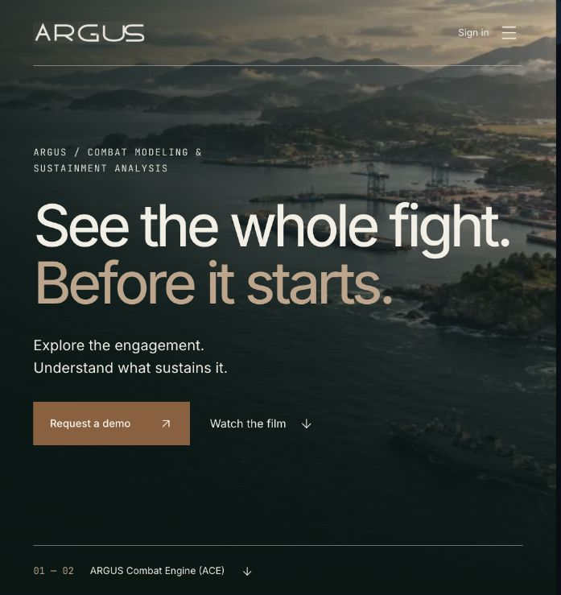

# ARGUS Platform

Defense analysis across combat modeling, wargaming, sustainment and historical research.

ARGUS connects the study of an engagement with the resources needed to sustain it. Analysts can explore scenarios and alternatives, inspect the supporting evidence, and bring their reasoning into briefs and after-action reports. [Explore the platform →](https://argusplatform.ai/)

## Explore the decision

- **Combat modeling:** examine force comparisons and the assumptions that influence an assessment.
- **Wargaming:** build a scenario, commit orders, review adjudication and investigate alternative courses of action.
- **Logistics and sustainment:** consider fuel, ammunition, replenishment, replacement and affordability alongside the operational question.
- **Historical research:** study engagements and campaigns with citations, evidence gaps and differing accounts visible.

A typical analytical workflow begins with a question and scenario, makes the assumptions explicit, compares alternatives, and carries the evidence into a reviewable brief. People retain decision authority. [Read the company and product brief →](https://pearllab.io/company-brief)

## A public record of research

ARGUS's [weekly forecast receipts](https://github.com/pearl-labs-llc/argus-forecast-receipts) document a specific Ukraine-front research experiment:

1. Publish a SHA-256 forecast commitment and resolution date.
2. Have a separate ARGUS agent confirm the commitment's timing.
3. Reveal the forecast after resolution so readers can check its hash.
4. Append scores under the published rule and preserve the record of unsuccessful forecasts.

The forecast experiment has not established demonstrated predictive skill. Its automated operator and confirmer provide separation of duties within ARGUS, not an independent audit.

Pearl Labs LLC · Public product overview · Application source remains private.
